# Αρχιτεκτονική Εφαρμογής & Tech Stack: HellenicInsight

Το **HellenicInsight** είναι μια πλατφόρμα ανάλυσης της πολιτικής μεροληψίας (bias) σε ελληνικά άρθρα ειδήσεων σε πραγματικό χρόνο, αξιοποιώντας μεθόδους Knowledge Distillation σε τοπικά Large Language Models (LLMs). Αναπτύχθηκε στο Hackathon από την ομάδα **BigO No** (CEID - University of Patras).

Παρακάτω αναλύεται η αρχιτεκτονική και το τεχνολογικό stack.

## Διάγραμμα Αρχιτεκτονικής (Pipeline)

Το παρακάτω διάγραμμα δείχνει την γραμμική ροή (pipeline) των δεδομένων από το scraping μέχρι την παρουσίαση στον τελικό χρήστη:

## Εργαλεία και Τεχνολογίες (Τι έχουμε και γιατί)

1. **Scrapy & Crawl4AI (Data Ingestion)**
   - **Τι είναι:** Εργαλεία για web scraping και asynchronous data extraction.
   - **Γιατί επιλέχθηκαν:** Απαραίτητα για να ξεπερνάμε anti-bot protections που έχουν τα ελληνικά ειδησεογραφικά sites και να συλλέγουμε δεδομένα γρήγορα από πολύπλοκα sitemaps, αντίθετα με απλές βιβλιοθήκες. Το Crawl4AI βοήθησε στην ασύγχρονη εξαγωγή δεδομένων.

2. **Apache Kafka (Message Broker / Streaming)**
   - **Τι είναι:** Σύστημα διαχείρισης ροής δεδομένων σε πραγματικό χρόνο.
   - **Γιατί επιλέχθηκε:** Αποσυζευγνύει (decouples) το scraping από το processing. Λειτουργεί ως "buffer" (backpressure handler), διασφαλίζοντας ότι τα δεδομένα περιμένουν στην "ουρά" και δεν χάνονται αν το AI μοντέλο καθυστερεί.

3. **Apache Spark Structured Streaming (Transform & Labeler)**
   - **Τι είναι:** Engine για κατανεμημένη επεξεργασία δεδομένων.
   - **Γιατί επιλέχθηκε:** 
     - *Transform:* Αναλαμβάνει το micro-batching και το string manipulation (ChatML string templating) στην CPU, γλιτώνοντας πολύτιμους κύκλους από τις GPUs.
     - *Labeler:* Λαμβάνει το αποτέλεσμα από το vLLM και το μορφοποιεί/προετοιμάζει για αποθήκευση.

4. **vLLM & Qwen + LoRA (AI Inference Engine & Base Model)**
   - **Τι είναι:** Σύστημα εκτέλεσης μοντέλων Τεχνητής Νοημοσύνης.
   - **Γιατί επιλέχθηκε:**
     - **vLLM:** Επιλέχθηκε για high-throughput concurrent inference. Υποστηρίζει εγγενώς *Prefix Caching* και *Continuous Batching*, ιδανικό για hardware επιπέδου **NVIDIA B200 (Blackwell)**.
     - **Τοπικό Μοντέλο (Qwen 14B / 35B):** Αντί για ακριβά enterprise APIs, φτιάξαμε μια δική μας εκδοχή. Το LoRA adapter έκανε το μοντέλο να "ξεχάσει" τον ρόλο του ως chatbot και να εξάγει αυστηρά JSON. Πετύχαμε έτσι αρχιτεκτονική χωρίς API costs (fully local).

5. **MongoDB (Storage - Persist)**
   - **Τι είναι:** NoSQL Βάση Δεδομένων.
   - **Γιατί επιλέχθηκε:** Τέλεια για την αποθήκευση JSON εγγράφων (άρθρα, metadata, tags και bias reasoning). Δεν απαιτεί αυστηρό σχήμα, επιτρέποντας ευελιξία.

6. **Node.js/Express & React (Frontend Dashboard)**
   - **Τι είναι:** Full-stack JavaScript εργαλεία.
   - **Γιατί επιλέχθηκαν:** Γρήγορη δημιουργία REST API και ενός fully routed, bilingual (Ελληνικά/Αγγλικά) real-time dashboard τύπου "Bloomberg" για το τελικό demo της εφαρμογής, παρέχοντας "Link-to-Insight" λειτουργικότητα.
